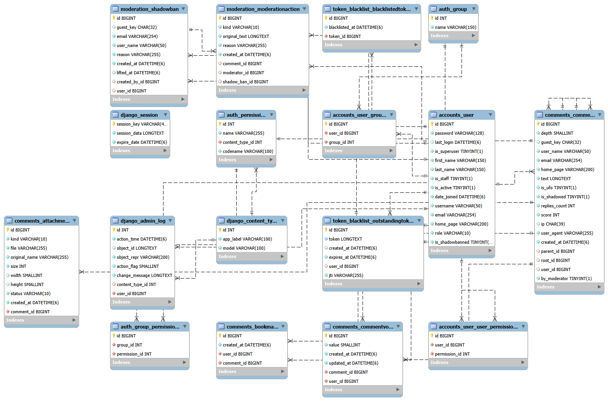
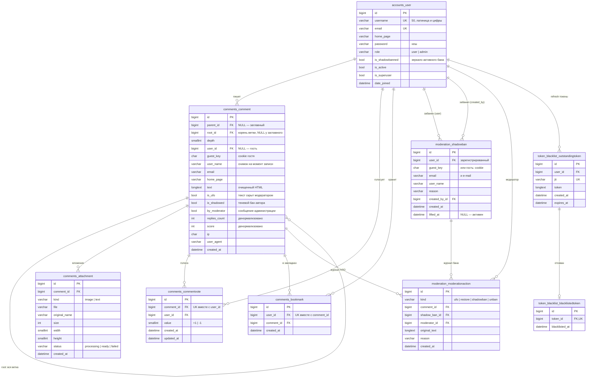

# dzen-test-back

Бэкенд тестового задания «SPA-комментарии»: древовидные комментарии с CAPTCHA, вложения, обновления
в реальном времени по WebSocket, модерация, поиск.

Стек: Python 3.14, Django 6, DRF, Strawberry GraphQL, Channels (WebSocket), MySQL 8.4, Redis,
Celery + RabbitMQ, Elasticsearch, JWT, Caddy, Docker.
Фронтенд: [dzen-test-front](https://github.com/sni10/dzen-test-front) (Vue 3).

> В работе.

## Ссылки

| Что | Где |
|---|---|
| Рабочий сайт | https://comments.185-233-44-60.sslip.io |
| REST API: Swagger UI | https://comments.185-233-44-60.sslip.io/api/docs/ |
| REST API: схема OpenAPI | https://comments.185-233-44-60.sslip.io/api/schema/ |
| GraphQL (в браузере — GraphiQL) | https://comments.185-233-44-60.sslip.io/graphql |
| GraphQL-схема | [schema.graphql](schema.graphql) |
| Схема БД (MySQL) | [db/schema.sql](db/schema.sql), модель MySQL Workbench — [db/schema.mwb](db/schema.mwb) |
| Состояние сервиса | https://comments.185-233-44-60.sslip.io/api/health/ |
| Нагрузочный тест | [loadtest/README.md](loadtest/README.md) |

### Примеры запросов

Первая страница ленты (25 заглавных комментариев, новые сверху) с первыми ответами:

```bash
curl -s https://comments.185-233-44-60.sslip.io/graphql \
  -H 'Content-Type: application/json' \
  -d '{"query": "{ comments(page: 1, sort: CREATED_AT_DESC) { totalCount pageCount items { id userName text createdAt repliesCount replies(first: 3) { items { id userName text } } } } }"}'
```

Поиск по словоформам с подсветкой:

```bash
curl -s https://comments.185-233-44-60.sslip.io/graphql \
  -H 'Content-Type: application/json' \
  -d '{"query": "{ search(query: \"комментарий\") { totalCount items { highlight comment { id userName } } } }"}'
```

Статистика и проверка сервиса:

```bash
curl -s https://comments.185-233-44-60.sslip.io/graphql \
  -H 'Content-Type: application/json' -d '{"query": "{ stats { comments ufo shadowed } }"}'
curl -s https://comments.185-233-44-60.sslip.io/api/health/   # {"status":"ok","db":true,"cache":true}
```

Публикация комментария (REST): получить CAPTCHA, затем отправить форму с её ключом и текстом с картинки.
Cookie нужна: по ней гость узнаётся как автор.

```bash
curl -s -c jar -b jar https://comments.185-233-44-60.sslip.io/api/captcha/
# {"key": "...", "image": "data:image/png;base64,..."} — текст с картинки вводится в captcha_answer
curl -s -c jar -b jar https://comments.185-233-44-60.sslip.io/api/comments/ \
  -H 'Content-Type: application/json' \
  -d '{"user_name": "Anonym", "email": "anonym@example.com", "text": "Hello, <strong>world</strong>",
       "captcha_key": "<key>", "captcha_answer": "<текст с картинки>"}'
```

## Схема БД

MySQL 8.4, InnoDB, utf8mb4. Полная схема со всеми индексами — [db/schema.sql](db/schema.sql), модель
MySQL Workbench — [db/schema.mwb](db/schema.mwb).

EER-диаграмма из MySQL Workbench (все таблицы, включая служебные таблицы Django):



Таблицы приложения со смыслом полей (без служебных таблиц Django — прав, сессий, журнала админки):



Индексы ленты — под каждую сортировку: `(parent_id, created_at | user_name | email, id, is_shadowed)`; ветка
читается по `(root_id, created_at, id)`. Почему так — в [отчёте нагрузочного теста](loadtest/README.md).

## Локальный запуск (Docker)

Compose поднимает всё приложение вместе с SPA, поэтому оба репозитория клонируются рядом:

```bash
git clone https://github.com/sni10/dzen-test-back.git
git clone https://github.com/sni10/dzen-test-front.git
cd dzen-test-back
cp .env.example .env
docker compose up --build
```

Откройте **http://localhost:8080**. Caddy отдаёт SPA и API с одного адреса, как в продакшене:

| Путь | Куда |
|---|---|
| `/graphql` | GraphQL (чтение комментариев, голоса, закладки, модерация, поиск; в браузере — GraphiQL) |
| `/api/...` | REST: CAPTCHA, публикация комментариев, предпросмотр, health; Swagger на `/api/docs/` |
| `/api/auth/...` | JWT: `register/`, `login/` (по имени или e-mail), `refresh/`, `logout/`. Access-токен (15 мин) передаётся в `Authorization: Bearer`, для WebSocket — в `?token=`; refresh-токен (7 дней, меняется при каждом обновлении) хранится в httpOnly-cookie |
| `/ws/comments/` | WebSocket: события `comment.created`, `comment.updated`, `comment.score`, `attachment.updated` приходят на все открытые страницы |
| `/media/...`, `/admin/`, `/static/...` | Django |
| всё остальное | SPA (nginx из dzen-test-front) |

Django также доступен на http://localhost:8000 (для прокси `npm run dev` во фронтенде).

Фоновая работа идёт в контейнере `worker` (Celery через RabbitMQ): прикреплённое изображение сначала
сохраняется (`status: processing`), затем вписывается в 320×240 и пересохраняется (`ready`). Интерфейс
RabbitMQ: http://localhost:15673 (`dzen` / `dzen`).

Администратор: `docker compose exec app python manage.py createsuperuser`.

**Поиск** (GraphQL `search(query)`, словоформы русского и английского, подсветка совпадений) работает на
Elasticsearch. Новые и отмодерированные комментарии индексирует воркер; полностью (пере)построить индекс —
на новом сервере или после изменения маппинга: `docker compose exec app python manage.py reindex`.

**Нагрузочный тест** на миллионе комментариев (`manage.py seed`, Locust) — как запустить и результаты:
[loadtest/README.md](loadtest/README.md).

## Разработка без контейнера приложения

MySQL, Redis, RabbitMQ и Elasticsearch в Docker, Django на хосте ([uv](https://docs.astral.sh/uv/)):

```bash
cp .env.example .env
docker compose up -d db redis rabbitmq elasticsearch
uv sync
uv run python manage.py migrate
uv run python manage.py runserver
uv run celery -A config worker --pool solo --loglevel info   # фоновые задачи (в другом терминале)
uv run python manage.py test
```

MySQL доступен на `127.0.0.1:3307` (пользователь и пароль из `.env`) — туда подключается MySQL Workbench.

## Git и релизы

- `main` — релизы, `dev` — интеграция, `feature/*` / `fix/*` — рабочие ветки, сливаются в `dev` через pull request.
- Сообщения коммитов — по [Conventional Commits](https://www.conventionalcommits.org/) (проверяется в CI).
- CI (`.github/workflows/ci.yml`): проверка коммитов и тесты на MySQL для каждого push и pull request в
  `main`/`dev`; при push в `main` — автоматический семантический тег `vX.Y.Z`, GitHub Release и Docker-образ
  `ghcr.io/sni10/dzen-test-back:<sha>` / `:vX.Y.Z`.
- На сервере интерфейс RabbitMQ слушает только `127.0.0.1:15672` самого сервера. Открывать через SSH-туннель:
  `ssh -L 15672:127.0.0.1:15672 deploy@<server>`, затем http://localhost:15672 с `RABBITMQ_USER` /
  `RABBITMQ_PASSWORD` из `.env` на сервере.
